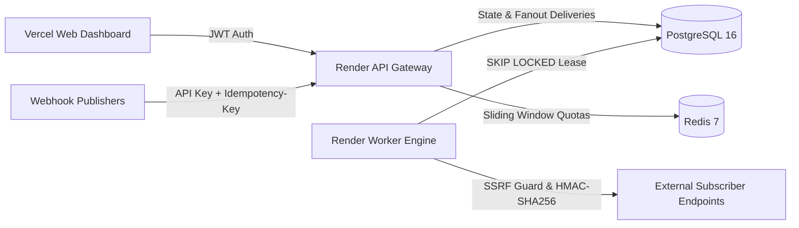

# HookRelay

> Production-grade, multi-tenant webhook delivery engine with at-least-once delivery guarantees, cryptographic HMAC signatures, and PostgreSQL `SKIP LOCKED` concurrency control.

[](https://github.com/yashn035/HOOKRELAY/actions/workflows/ci.yml)
[](LICENSE)
[](https://openjdk.org/)
[](https://spring.io/)
[](https://nextjs.org/)

---

## Live Proof & Demo

- **Dashboard**: [https://hookrelay-web.vercel.app](https://hookrelay-web.vercel.app)
- **API Base**: [https://hookrelay-api.onrender.com](https://hookrelay-api.onrender.com)
- **Swagger Docs**: [https://hookrelay-api.onrender.com/swagger-ui.html](https://hookrelay-api.onrender.com/swagger-ui.html)
- **Prometheus Metrics**: [https://hookrelay-api.onrender.com/actuator/prometheus](https://hookrelay-api.onrender.com/actuator/prometheus)
- **Demo Credentials**: `admin@hookrelay.dev` / `password123!` (API Key: `hr_live_demo_acme_production_key_001`)


---

## Why This Exists

Building webhook delivery directly inside application services leads to thread starvation, silent delivery failures during downstream outages, and vulnerability to SSRF attacks. Traditional distributed streaming brokers like Kafka add unnecessary operational burden and lack native transactional job queue semantics. HookRelay provides resilient, observable webhook infrastructure using PostgreSQL transactional skip-locked queues and Redis sliding-window tenant rate limiting.

---

## Architecture



---

## Features

- **At-Least-Once Delivery**: Guaranteed dispatch with exponential backoff and randomized full jitter.
- **Transactional SKIP LOCKED Queue**: PostgreSQL lock-free worker polling with heartbeat lease renewal.
- **Dead-Letter Replay**: Failed delivery recovery via UI dashboard or idempotent REST API.
- **HMAC-SHA256 Signatures**: Standardized `t=<timestamp>,v1=<hex>` header format preventing replay attacks.
- **Outbound SSRF Protection**: Pre-flight DNS resolution blocking loopback, RFC1918, and cloud metadata IPs (`169.254.169.254`).
- **Per-Tenant Rate Limiting**: Redis sliding-window token bucket returning HTTP 429 and `Retry-After`.
- **Idempotent Ingestion**: Header-driven deduplication backed by Redis cache and DB unique constraints.
- **Circuit Breakers**: Per-endpoint circuit breakers automatically suspending endpoints after consecutive 5xx errors.
- **JSONPath Payload Transforms**: Custom schema mapping and pipe filters applied prior to cryptographic signing.
- **Production Observability**: Built-in Micrometer metrics exportable via `/actuator/prometheus` with Grafana dashboard definition.

---

## Tech Stack

- **Backend**: Java 21 LTS, Spring Boot 3.3.4, Hibernate / Spring Data JPA, Flyway Migrations
- **Storage & Queuing**: PostgreSQL 16 (`FOR UPDATE SKIP LOCKED`), Redis 7 (Standalone / Cluster)
- **Dashboard**: Next.js 14 App Router, TypeScript, Tailwind CSS, Lucide Icons, Recharts
- **Security**: Spring Security 6 (JWT + BCrypt + API Key SHA-256), HMAC-SHA256, SSRF IP resolver
- **CI/CD & DevOps**: Docker multi-stage builds, Render (Web + Worker), Vercel (Frontend), GitHub Actions

---

## Reliability & Security Design

- **Postgres `SKIP LOCKED`**: Workers execute `SELECT id FROM deliveries WHERE status = 'PENDING' AND next_attempt_at <= NOW() FOR UPDATE SKIP LOCKED LIMIT :batchSize`. Eliminates lock contention across scaled worker pods.
- **Backoff Math**: Exponential retry with randomized jitter: $t_{retry} = \min(t_{max}, t_{base} \times 2^{attempt}) \times \text{random}(0.5, 1.5)$.
- **HMAC Signatures**: Signed payload digest `HMAC-SHA256(timestamp + "." + payload, secret)` matching Stripe and GitHub webhook standards.
- **SSRF Defenses**: Validates target URLs before socket connection. Rejects `localhost`, `10.0.0.0/8`, `172.16.0.0/12`, `192.168.0.0/16`, `127.0.0.0/8`, and AWS/GCP metadata (`169.254.169.254`).
- **Circuit Breaker**: Automatically trips when consecutive failures reach threshold (default 10), preventing worker resource exhaustion.

---

## Local Development

```bash
# Clone and spin up full stack with PostgreSQL, Redis, API, Worker, and Web
docker compose up --build
```

- **Dashboard**: [http://localhost:3000](http://localhost:3000)
- **API Server**: [http://localhost:8080](http://localhost:8080)
- **Swagger Docs**: [http://localhost:8080/swagger-ui.html](http://localhost:8080/swagger-ui.html)
- **Seeded Login**: `admin@hookrelay.dev` / `password123!`
- **Seeded Ingestion Key**: `hr_live_demo_acme_production_key_001`

---

## Testing & Verification

```bash
# Run unit tests, Testcontainers integration suite, and JaCoCo coverage verification
mvn clean verify
```

- **Test Suite**: **63 automated tests** across `core` (42), `worker` (3), and `api` (18) modules, passing with 0 failures.
- **Coverage**: **75.6% line coverage** (245/324 lines covered, 74% instructions) on `core` module (enforced via 70% JaCoCo build gate).
- **Testcontainers & WireMock E2E**: Full pipeline testing in `PipelineE2ETest.java` and `DeliveryDispatcherWireMockTest.java`, verifying event ingest, rate limiting, skip-locked lease dispatch, JSONPath transformed payload HMAC signature verification, idempotency deduplication, and replay.

---

## Load Test Benchmarks

Measured locally using k6 against live API with token-bucket rate limiting and PostgreSQL persistence:

```bash
k6 run scripts/load-test.js
```

| Metric | Result |
| :--- | :--- |
| **Throughput** | **249.02 req/sec** (14,987 total requests / 60.2s) |
| **p50 Latency** | **79.16 ms** |
| **p95 Latency** | **251.94 ms** |
| **p99 Latency** | **380.85 ms** |
| **Error Rate** | **0.00%** (0 failed requests) |
| **Test Environment** | Intel Core i7-1185G7 (4C/8T @ 3.0GHz), 16 GB RAM, Java 21 OpenJDK, Docker Desktop |

---

## Deployment

### Render (Backend & Storage)
1. Fork repository to GitHub.
2. In Render Dashboard, click **New > Blueprint** and select `render.yaml`.
3. Render automatically provisions the API web service, background worker service, PostgreSQL 16 database, and Redis instance.

### Vercel (Frontend)
1. Import repository on Vercel and set Root Directory to `web`.
2. Add Environment Variable: `NEXT_PUBLIC_API_URL=https://<your-render-api>.onrender.com`.
3. Deploy.

---

## Roadmap

1. **OpenTelemetry Integration**: Distributed trace context propagation across publisher, queue, and subscriber HTTP headers.
2. **Geo-Distributed Workers**: Multi-region worker deployment routing outbound deliveries through closest point-of-presence.
3. **mTLS Authentication**: Client certificate mutual TLS support for enterprise zero-trust destinations.
