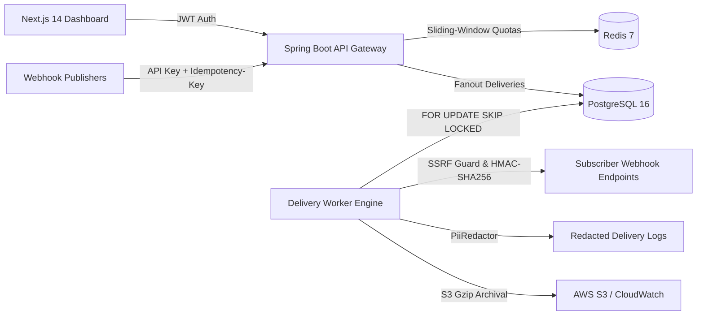

# HookRelay

> High-throughput, distributed webhook delivery engine engineered with Java 21, Spring Boot, PostgreSQL transactional `SKIP LOCKED` queues, Redis rate-limiting, and an enterprise-grade Quality Engineering & Chaos testing suite.

[](https://github.com/yashn035/HOOKRELAY/actions/workflows/ci.yml)
[](https://openjdk.org/)
[](https://spring.io/)
[](https://nextjs.org/)
[](https://www.postgresql.org/)
[](https://redis.io/)
[](LICENSE)

---

## Live Links & Demo

- **Web Dashboard**: [https://hookrelay-web.vercel.app](https://hookrelay-web.vercel.app)
- **API Base URL**: [https://hookrelay-api.onrender.com](https://hookrelay-api.onrender.com)
- **Swagger / OpenAPI**: [https://hookrelay-api.onrender.com/swagger-ui.html](https://hookrelay-api.onrender.com/swagger-ui.html)
- **Prometheus Metrics**: [https://hookrelay-api.onrender.com/actuator/prometheus](https://hookrelay-api.onrender.com/actuator/prometheus)
- **Demo Credentials**: `admin@hookrelay.dev` / `password123!` (API Key: `hr_live_demo_acme_production_key_001`)

---

## Quality Engineering & Automation

HookRelay implements a shift-left testing strategy spanning automated performance baselines, chaos simulation, contract validation, and data security:

| Domain | Tooling & Harness | Verification Scope & Enforced Guarantees |
| :--- | :--- | :--- |
| **Performance** | **k6 + GitHub Actions** | Ramping load test targeting **1000 RPS**; strict CI SLO gates (`p95 < 200ms`, `p99 < 500ms`, error rate `< 1%`). |
| **End-to-End (E2E)** | **Playwright (TypeScript)** | Full browser automation for authentication, project creation, endpoint CRUD, test dispatching, and manual/bulk DLQ replay. |
| **Chaos Engineering** | **Toxiproxy + Testcontainers** | Injects upstream network degradation: **1500ms latency** (resilience verification) and **TCP reset_peer** (validates retry exhaustion & DLQ routing). |
| **Contract Testing** | **Python 3.12 + pytest** | Automated OpenAPI spec validation (`openapi-spec-validator`) and schema adherence (`jsonschema`) for `202 Accepted` event ingest endpoints. |
| **Security & Privacy** | **PiiRedactor (Core Service)** | Recursive JSON/regex masking for sensitive PII (Emails, Phones, SSNs, Credit Cards) before logging delivery attempts. |
| **Observability** | **Micrometer + Prometheus + AWS** | Dual metrics pipeline with latency drift and retry cost monitoring; AWS S3 gzip+AES256 log archival and CloudWatch exporter (mocked via LocalStack). |

---

## Architecture



---

## Core Features

- **At-Least-Once Delivery**: Exponential retry backoff with full randomized jitter ($t_{retry} = \min(t_{max}, t_{base} \cdot 2^{attempt}) \cdot \text{rand}(0.5, 1.5)$).
- **Postgres `SKIP LOCKED`**: High-concurrency worker polling with heartbeat lease renewal without table-level locking.
- **Dead-Letter Queue (DLQ) & Replay**: Non-destructive replay of exhausted deliveries via web UI or bulk REST endpoints.
- **HMAC-SHA256 Signatures**: Standardized `t=<timestamp>,v1=<hex>` header digest protecting subscribers against replay attacks.
- **Outbound SSRF Protection**: Pre-flight DNS validation rejecting private IPs (`10.0.0.0/8`, `192.168.0.0/16`, `127.0.0.0/8`) and cloud metadata (`169.254.169.254`).
- **Sliding-Window Rate Limiting**: Per-project Redis token-bucket algorithm returning standard `429 Too Many Requests` and `Retry-After`.
- **Payload Transformations**: Declarative JSONPath extraction and filtering applied before signing and delivery.

---

## How to Run Tests

### 1. Backend Verification (Unit, Integration, WireMock, Chaos & JaCoCo)
```bash
./mvnw clean verify
```

### 2. End-to-End Browser Tests (Playwright)
```bash
cd web
npx playwright test
cd ..
```

### 3. Automated OpenAPI Contract Tests (Python)
```bash
pip install -r qa-tests/requirements.txt
pytest qa-tests
```

### 4. Performance & Load Tests (k6)
```bash
k6 run scripts/load-test.js
```

---

## Local Development

Spin up the entire local infrastructure (PostgreSQL 16, Redis 7, API Gateway, Delivery Worker, and Web Dashboard):

```bash
docker compose up --build
```

- **Web Dashboard**: [http://localhost:3000](http://localhost:3000)
- **API Gateway**: [http://localhost:8080](http://localhost:8080)
- **Swagger Documentation**: [http://localhost:8080/swagger-ui.html](http://localhost:8080/swagger-ui.html)
- **Prometheus Metrics**: [http://localhost:8080/actuator/prometheus](http://localhost:8080/actuator/prometheus)
